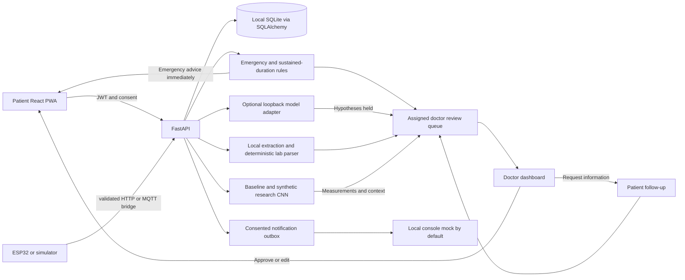

# Architecture

FastAPI dependencies enforce role, owner/clinician assignment, token revocation and current consent. Shared sensor packets enforce numeric bounds, timestamps, device/event IDs and kind-specific fields. WebSockets authenticate through the first message rather than a URL token. SSE provides a local simulator stream. Data and original uploads remain in the local database.

The sync/async SQLAlchemy engines use explicit connection lifetimes. Additive SQLite migrations preserve existing consent and bookings. Active appointment slots have a partial unique index; booking/blocking changes recheck availability inside serialized transactions.

Clinical release is separate from generation. Emergency templates apply immediately and are also queued; other preliminary possibilities remain withheld until the assigned doctor approves. Request-info replies preserve original records and requeue the same case with a new review clock. Follow-up emergency phrases create immediate guidance and an emergency case. A background worker expires pending reviews to conservative fallback advice.

Clinical audit entries are private and erasable. A second append-only HMAC-linked chain stores opaque actor identities/categories for integrity checks; it is not externally notarized or proof against compromise of the machine/key.

Public PWA shell assets may be cached. Authenticated APIs, WebSockets and clinical data are never cached by the service worker. External notification transports remain disabled without configuration and explicit consent.
